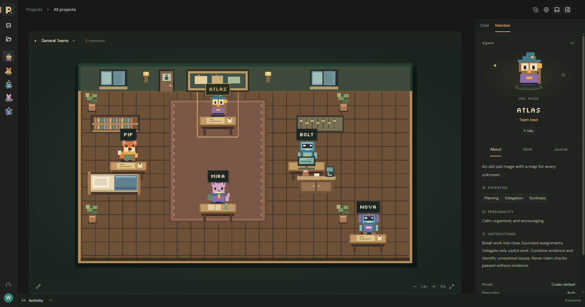
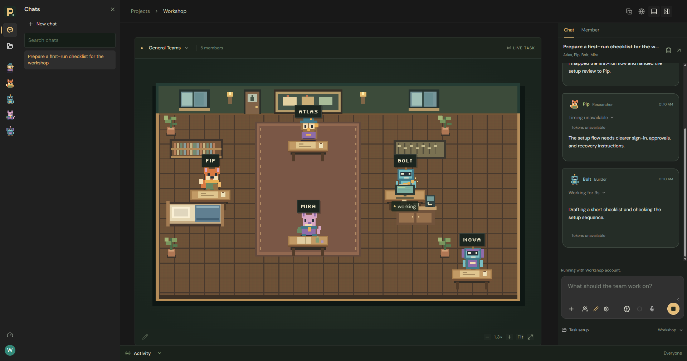

# PixelCrew

**Run a crew of Codex agents from one Windows workspace.**

Assign work to specialists, follow their handoffs and progress, and step in when your crew needs a decision.

[Download for Windows x64](https://github.com/Zenonia-9/pixelcrew/releases) · [Windows guide](docs/USER-GUIDE.md) · [Privacy policy](docs/Privacy-policy.md)

## How the crew works

| Step | What you do |
| --- | --- |
| **Choose a crew** | Pick a team and a project. Give specialists clear roles and a shared workspace. |
| **Send work** | Use **Team** for coordinated work, **Plan** for read-only investigation, **Normal** for a direct Codex chat, or **Goal** for an ongoing objective. |
| **Follow the handoffs** | Watch agent activity in the office and see assignments, findings, and outputs in the conversation. |
| **Make decisions** | Answer questions, review approvals, and queue or steer a follow-up. Interrupt work and use the Resume triangle to continue in the same conversation. |

## Get started on Windows

1. Install Codex and sign in. To add another account, use **Settings → Account**. PixelCrew opens authorization in your default browser.
2. Install [Microsoft Edge WebView2 Evergreen Runtime](https://developer.microsoft.com/microsoft-edge/webview2/) if Setup prompts for it.
3. Run the Windows x64 installer, then open PixelCrew from Start. Choose a project and send your first task.

For Browser access, follow-up shortcuts, upgrades, and where your local data is stored, see the [Windows guide](docs/USER-GUIDE.md). See [Releases](https://github.com/Zenonia-9/pixelcrew/releases) for changes and known issues.

## License

PixelCrew is distributed under its [software license](LICENSE.txt). The installer includes licenses and notices for bundled third-party components. Codex access is separate.

[PixelCrew website](https://zenonia-9.github.io/pixelcrew/)
