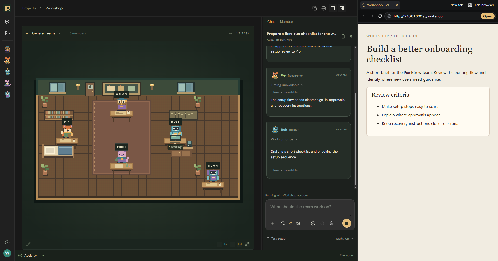

# PixelCrew Windows guide

## 1. Install and open PixelCrew

Download the Windows x64 installer from [PixelCrew Releases](https://github.com/Zenonia-9/pixelcrew/releases). Run Setup and choose whether to install for your Windows account or all users. The all-users option requires administrator approval.

Install [Microsoft Edge WebView2 Evergreen Runtime](https://developer.microsoft.com/microsoft-edge/webview2/) if Setup prompts for it. Open **PixelCrew** from Start or the optional desktop shortcut.

## 2. Connect a Codex account

Install Codex separately. If you are signed in to Codex desktop, PixelCrew can use that connection. To add an account, open **Settings → Account**, then choose **Add account** for standard Codex sign-in or **Add PixelCrew account** for eligible plan access.

Complete authorization in your default browser and return to PixelCrew. If the browser did not open, use **Open sign-in again** to retry the same attempt. Use the account menu to switch accounts. Work in progress keeps its original account.

## 3. Work with agents

Use **Projects** to open a workspace, search and pin projects, or expand a project's chat list. Use **Chats** to search or start a conversation. Choose **Team** to coordinate specialists, **Plan** to investigate read-only, **Normal** to work directly with Codex, or **Goal** for an ongoing objective.

Follow specialist progress, handoffs, and results in the conversation. Approve requests or answer questions when the crew needs a decision. While a turn is running, the square interrupts it. Typing a draft switches the square to Send. After an interruption, clear the draft to show the Resume triangle. It continues in the same conversation.

| Shortcut | Behavior |
| --- | --- |
| Enter | Sends the message with your configured follow-up preference |
| Ctrl+Enter | Uses the opposite follow-up behavior for this message |
| Shift+Enter | Starts a new line |

Set your default follow-up preference in **Settings → General**.

## 4. Work with the in-app Browser

Use the Browser icon to open or hide the panel. Agent access starts off. To grant access, enable **Allow agents to use Browser** under **Settings → General** and select Browser in the chat. Each chat uses an isolated browser profile.

**Approve for me** skips prompts for hover, click, type, and drag when that approval mode applies. Opening a site and resetting Browser still ask. Turn off agent access in Settings to block further agent Browser calls.

## 5. Upgrade and keep your data

Closing the window sends PixelCrew to the notification area, so active work can continue. Reopen from Start or the tray icon. To upgrade, choose **Quit PixelCrew** from the tray and then run the new installer over the existing installation.

Each Windows user has separate data in `%LOCALAPPDATA%\PixelCrew`. Back it up while PixelCrew is stopped. When uninstalling through Windows Settings, choose **No** if asked to remove PixelCrew data you want to keep.
